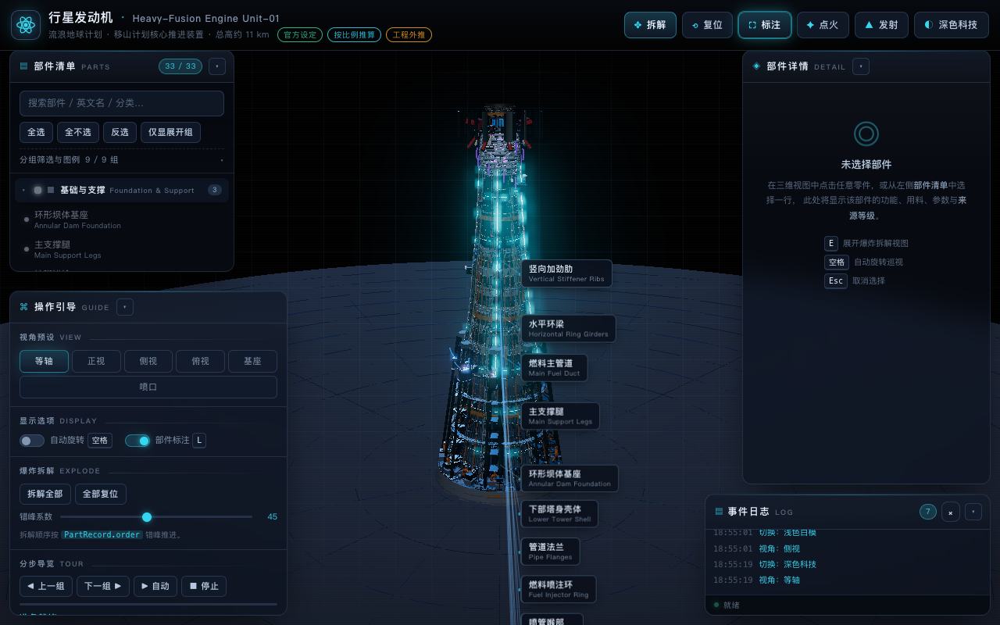
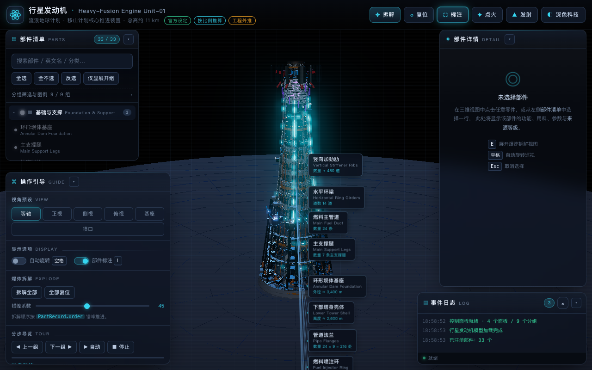
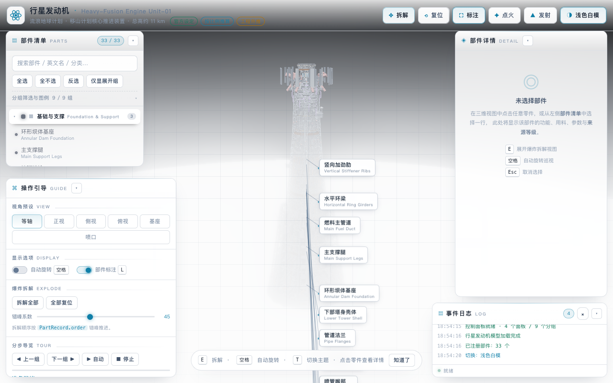
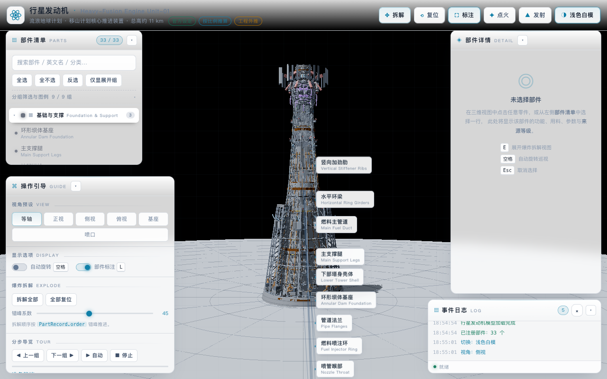
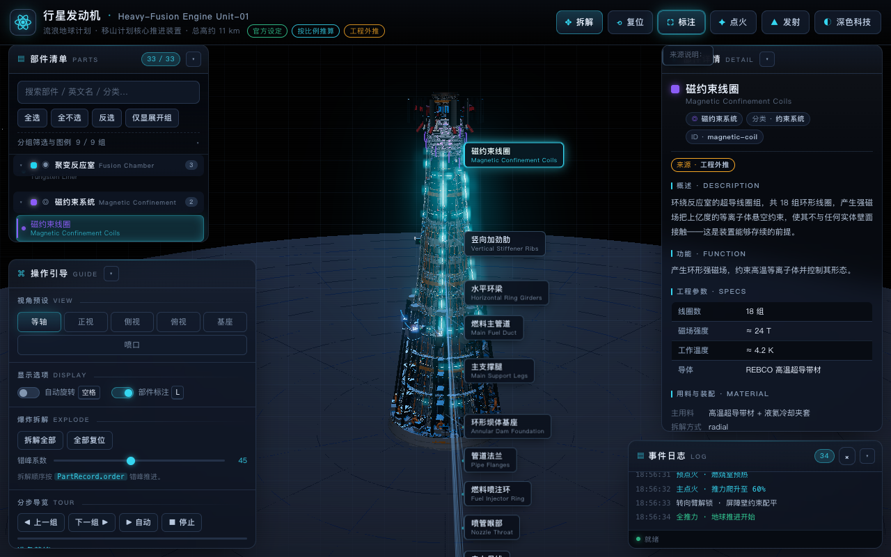

# 行星发动机 · 拆解可视化

> **Planetary Engine — Interactive Exploded View**
> 基于《流浪地球》官方设定重建的巨型行星发动机三维拆解可视化页面。

[](https://github.com/nova-fable/planet-engine/actions/workflows/deploy.yml)
[](https://threejs.org/)
[](LICENSE)

**在线体验：<https://planet-engine.zxinrun.cn>**

---

## 这是什么

《流浪地球》中，人类在地球表面建造了上万座行星发动机，以重核聚变推动地球逃离太阳系。
本项目用 **纯程序化几何**（不依赖任何外部 3D 模型文件）在浏览器中重建了其中一座发动机，
并做成可交互的**拆解视图**——可以逐层展开、点击查看每个部件的参数与来源、模拟点火与发射。

打开页面即可看到：

- 一座 11 km 高的锥形巨塔，由 **环形坝体** 与 **七条主支撑腿** 托起
- 塔身外壁攀爬着 24 条燃料主管道，中段环绕散热鳍片与水平环梁
- 上部是 **中央承重柱/重聚变燃烧室**，被 18 组磁约束线圈包裹
- 顶端是位于云层之上的 **喷口阵列**，由七组 **喷口转向臂** 与屏障壁环绕

点击任意部件，右侧会显示它的功能、用料、工程参数与**资料来源等级**；
按下 `E` 或点击「拆解」，整台机器会按结构层次错峰展开。

---

## 预览

**深色科技主题 · 等轴视角**



**部件标注 · 名称与参数**

每个标注显示「中文名 + 英文名 + 关键参数」，带引线指向部件，自动去重叠。



**浅色白模主题**





**模拟发射**



---

## 功能一览

### 模型主体

| 项目 | 说明 |
|---|---|
| 部件总数 | **33 个**，归入 9 大系统 |
| 几何规模 | **480,758** 三角面 · 1,963 个网格 · 325 个实例化网格 |
| 螺栓级细节 | 六角头螺栓以 `InstancedMesh` 生成，**每一颗都可单独拾取高亮** |
| 燃料管路 | 24 条主管道 + 法兰 + 膨胀弯 + 泵组 + 喷注环 |
| 结构体系 | 坝体、七条斜撑主腿、三段收分壳体、14 道环梁、约 480 道竖向加劲肋 |
| 核心系统 | 中央承重柱、点火核心、18 组磁约束线圈、低温冷屏、钨基内衬 |
| 推进系统 | 喉部、喷口阵列、8 组作动器、七组转向臂与屏障壁 |
| 辅助系统 | 检修平台、升降竖井、塔顶吊机、电缆桥架、航空障碍灯、警示标识 |

### 交互功能

- **点击部件触发拆解** —— 拾取任意零件展开，33 个部件按结构顺序错峰运动，动画**可中断、可逆、复位零漂移**
- **自由旋转缩放** —— 拖拽旋转 / 滚轮缩放 / 右键平移，含惯性阻尼
- **6 个视角预设** —— 等轴 · 正视 · 侧视 · 俯视 · 基座 · 喷口
- **部件详情** —— 概述、功能、参数表、用料、拆解元数据与来源说明
- **模拟点火** —— 7 步序列：燃料泵 → 磁约束励磁 → 喷注 → 火石点火 → 重核聚变 → 喷口起振 → 推力稳定
- **模拟发射** —— 6 步序列：自检 → 坝体水冷 → 预点火 → 主点火 → 转向臂配平 → 全推力

### 视觉风格

- **深色科技** —— 近黑蓝底、青色霓虹、玻璃拟态面板
- **浅色白模** —— 类 CAD/白模工作区，浅灰黏土质感、柔和描边
- 两套主题一键切换，**3D 材质、灯光、地面、雾效同步变化**

### 技术特性

- **仅使用 Three.js** —— r160，本地内置，**无 CDN 依赖**
- **发光高亮** —— `UnrealBloomPass` 后处理 + emissive 材质 + 加法混合等离子体
- **部件标注** —— 3D 投影跟随标注，显示 **中文名 + 英文名 + 关键参数**，带引线，自动去重叠
- **零构建步骤** —— 原生 ES module，`node serve.mjs` 即可运行
- **零外部资源** —— 所有贴图程序化生成，不加载任何外部模型/图片/字体

### 附加面板

- **部件清单面板** —— 9 组分类、搜索、筛选、折叠，与 3D 视图悬停联动
- **操作引导面板** —— 视角预设、显示开关、拆解系数、分步导览、序列进度、快捷键表
- **事件日志面板** —— 实时输出操作与序列状态

---

## 快速开始

```bash
git clone git@github.com:nova-fable/planet-engine.git
cd planet-engine
node serve.mjs
# 浏览器打开 http://127.0.0.1:8099
```

> **必须通过 HTTP 访问。** 项目使用原生 ES module，浏览器不允许以 `file://` 协议加载模块。

自定义端口：

```bash
PORT=3000 node serve.mjs
```

运行测试：

```bash
node tests/contracts.test.mjs   # 28 项：数据契约与来源诚实性
node tests/test-assembly.mjs    # 66 项：几何 / 设定一致性 / 动画 / 特效
```

两套测试均为 **headless**，不需要 WebGL，可直接在 CI 中运行。

---

## 官方资料校正

> 这一节记录本项目**最重要的一个技术决策**，也是它区别于网络上多数同人模型的地方。

建模前查阅了影片视效制作方 **MOREVFX** 公开发布的视效解析，并逐条核对原文。
这纠正了本项目早期实现中的一个关键错误：

| 项目 | 早期错误实现 | 官方事实 |
|---|---|---|
| **喷口朝向** | 朝下，地面设导流槽 | ✅ **朝上**——原文「发动机**喷口在云层之上**」 |
| **基座形式** | 环形基座 + 24 组径向支撑墩 | ✅ **环形坝体**（「坝体内外」）+ **七条主支撑腿** |
| **部件划分** | — | ✅ 官方分为「喷口、支撑腿上下、腰部细节、坝体内外」六部分 |
| **核心命名** | 泛称"聚变反应室" | ✅ 官方命名 **点火核心**、**中央承重柱/燃烧室**、**喷口转向臂**、**火石** |
| **结构设计意图** | — | ✅ 因剧中有猛烈地震，支撑结构须能**相互分担受力**并**加强缓冲** |

来源（已核对原文）：

- [MOREVFX《流浪地球2》视效解析 Vol.1 · 行星发动机](https://api.bilibili.com/x/article/view?id=22965179)
- [MOREVFX《流浪地球》视效解析 Part 1 · 气氛及设计细化](https://www.bilibili.com/read/cv2337961)

### 数据来源诚实性

每个部件都带 `source` 三级标注，**绝不把推测包装成官方设定**：

| 等级 | 含义 | 数量 |
|---|---|---|
| `official` | 官方材料中明确出现，附可核对出处 | 6 项 |
| `derived` | 由官方尺度按工程比例推算 | 若干 |
| `extrapolated` | 为实现可视化所做的合理工程外推 | 多数 |

已知的官方口径矛盾也如实记录在 `ENGINE_META.note`：

- 官方自身对高度（**8000 米** / **9000 多米**）与直径（**36 公里** / **30 公里**）说法不一致
- 常被引用的 **11000 米实为刘慈欣小说设定，并非电影设定**——本项目仅用它作为可视化标称高度
- 民间推测的「150 亿吨推力」**未被采用**为官方数据

---

## 项目结构

```
planet-engine/
├── index.html                 单页外壳（唯一入口 ./src/main.js）
├── serve.mjs                  零依赖静态服务器（正确的 ES module MIME）
├── CNAME                      GitHub Pages 自定义域名
├── AGENTS.md                  开发规范（编码 / 提交 / 协作）
├── README.md
├── .github/workflows/
│   └── deploy.yml             自动部署到 gh-pages 分支
├── src/
│   ├── main.js                编排：渲染器 / 相机 / 灯光 / 主题 / 拾取 / 主循环
│   ├── registry.js            共享契约：部件注册表、分组定义
│   ├── data/parts.js          33 个部件知识库（描述 / 参数 / 来源）+ 点火发射序列
│   ├── materials.js           共享材质库 + 深浅双主题调色（程序化贴图）
│   ├── geometry.js            几何工厂：螺栓 / 肋条 / 法兰 / 管路 / 桁架 / 格栅
│   ├── assembly.js            按数据装配整机
│   ├── animation.js           拆解动画引擎（错峰 / 可逆 / 可中断）
│   ├── effects.js             点火发射特效（等离子体 / 激波 / 火花 / 屏震）
│   ├── postprocessing.js      EffectComposer + UnrealBloom 封装
│   ├── ui/
│   │   ├── panels.js          四个面板：清单 / 详情 / 引导 / 日志
│   │   └── labels.js          3D 部件标注（投影跟随 / 引线 / 去重叠）
│   └── styles/
│       ├── theme.css          双主题 CSS 变量 + 玻璃拟态
│       └── panels.css         面板布局 + 标注样式 + 响应式
├── vendor/
│   ├── three.module.js        Three.js r160（本地内置）
│   └── addons/                OrbitControls / EffectComposer / UnrealBloomPass…
└── tests/
    ├── contracts.test.mjs     28 项数据契约测试
    ├── test-assembly.mjs      66 项几何与行为测试
    └── verify.mjs             端到端浏览器验证脚本
```

---

## 操作说明

| 操作 | 说明 |
|---|---|
| 拖拽 | 旋转视角 |
| 滚轮 / 双指 | 缩放 |
| 右键拖拽 | 平移 |
| 点击部件 | 选中并查看详情 |
| `E` | 展开 / 复位拆解视图 |
| `R` | 视角复位 |
| `L` | 标注开关 |
| `T` | 主题切换 |
| `I` | 模拟点火 |
| `空格` | 自动旋转 |
| `Esc` | 取消选择 |

---

## 部署

推送到 `master` 即自动构建并发布到 `gh-pages` 分支，由 GitHub Pages 托管。

```
master ──push──▶ GitHub Actions ──▶ gh-pages 分支 ──▶ GitHub Pages
                                                        │
                                          planet-engine.zxinrun.cn
```

工作流见 [`.github/workflows/deploy.yml`](.github/workflows/deploy.yml)。

### 首次部署需在 GitHub 网页端完成

由于 Actions 无权修改仓库设置，以下**需手动操作一次**：

1. **Settings → Pages → Build and deployment**
   - Source 选择 **Deploy from a branch**
   - Branch 选择 **`gh-pages`** / 目录 **`/ (root)`**，保存
2. **Settings → Pages → Custom domain** 填入 `planet-engine.zxinrun.cn`，保存
3. 勾选 **Enforce HTTPS**（证书签发通常需几分钟到数小时）

### DNS 配置

`CNAME` 文件已写入仓库，DNS 需配置：

| 类型 | 主机记录 | 记录值 |
|---|---|---|
| CNAME | `planet-engine` | `<owner>.github.io` |

> ⚠️ **注意**：当前 `planet-engine.zxinrun.cn` 实际解析到 **`xinrun0928.github.io`**，
> 而目标仓库位于 **`nova-fable`** 组织下。GitHub Pages 签发 HTTPS 证书时会校验
> 域名解析与站点归属是否一致，**两者不匹配会导致 `Enforce HTTPS` 无法启用**
> （现已可复现：访问该域名返回 `SSL: no alternative certificate subject name matches`）。
>
> 请二选一：
> - 把 CNAME 记录指向 **`nova-fable.github.io`**，或
> - 将仓库转移到 **`xinrun0928`** 账号下

---

## 已知限制

- 模型为**程序化重建**，非官方模型；官方未公布完整机械图纸，结构分层与零件布局属于合理重建
- 三角形数 480,758，略高于常规网页预算；低端设备可减少 `geometry.js` 中的实例数量与曲面分段
- 软件渲染（SwiftShader）下约 51 fps，真实 GPU 会显著更高
- 本模型标称高度 11,000 单位，为可视化尺度，**不等于官方公布的 8,000 米**

---

## 参与开发

请先阅读 [`AGENTS.md`](AGENTS.md) —— 其中规定了代码风格、提交信息规范与协作流程。

```bash
node tests/contracts.test.mjs && node tests/test-assembly.mjs   # 提交前必须全绿
```

---

## 许可

代码以 [MIT](LICENSE) 授权。

「流浪地球」「行星发动机」相关设定与世界观版权归原著作者及影片权利方所有。
本项目为非商业性的技术演示与学习用途，模型为独立程序化重建，不含任何官方素材。
